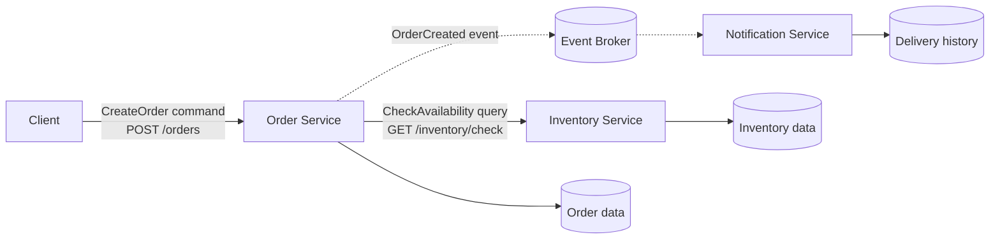

# Distributed Online Store Services

This project demonstrates a small distributed online store organized around clear service boundaries and data ownership. The executable implementation contains independent Order and Inventory processes communicating through HTTP, while the architecture also shows how a Notification Service can react to an `OrderCreated` event.

## Architecture



The solid path is implemented in this repository. The dotted event path shows the intended Notification integration; an event broker and Notification process are outside the minimum implementation scope.

## Responsibilities and data ownership

| Component | Responsibility | Data it owns |
|---|---|---|
| Order Service | Validate requests, query availability, create orders, and track order status | Order IDs, customer IDs, requested items, quantities, and order status |
| Inventory Service | Answer availability queries from its stock records | Item IDs and available quantities |
| Notification Service | Notify customers after receiving an `OrderCreated` event | Notification preferences, delivery attempts, and delivery status |
| Event Broker | Deliver events from producers to interested consumers | Temporary event records and delivery metadata, depending on broker configuration |

These boundaries follow business capabilities. Order does not read or modify Inventory's internal data; it asks Inventory through a published contract. Notification does not participate in order creation, so notification failure cannot prevent an otherwise valid order from being accepted. Each service can therefore change, scale, and recover independently while remaining authoritative for its own data.

## Command Query and Event classification

| Interaction | Classification | Reason |
|---|---|---|
| Check whether an item is available | Query | It requests information and does not intend to change Inventory state. |
| Create an order | Command | It asks Order Service to perform an action that may create a new order record. |
| Order was created | Event | It reports a fact that already happened so that interested consumers can react. |

## Project structure

```text
.
├── README.md
├── demo.py
├── inventory_service.py
├── order_service.py
└── requirements.txt
```

## Installation

Python 3.10 or newer is recommended.

```bash
python3 -m venv .venv
source .venv/bin/activate
python -m pip install --upgrade pip
python -m pip install -r requirements.txt
```

## Run the services

Start Inventory Service in terminal 1:

```bash
source .venv/bin/activate
python inventory_service.py
```

Inventory listens on `http://127.0.0.1:5001`.

Start Order Service in terminal 2:

```bash
source .venv/bin/activate
INVENTORY_TIMEOUT_SECONDS=1 python order_service.py
```

Order listens on `http://127.0.0.1:5000`. The two commands start independent operating-system processes.

## Successful request

From terminal 3, submit an available order:

```bash
curl -i -X POST http://127.0.0.1:5000/orders \
  -H "Content-Type: application/json" \
  -d '{"customer_id":"customer-101","item_id":"book","quantity":2}'
```

Example response:

```http
HTTP/1.1 201 CREATED
Content-Type: application/json

{
  "customer_id": "customer-101",
  "item_id": "book",
  "order_id": "<generated UUID>",
  "quantity": 2,
  "status": "created"
}
```

## Unavailable inventory

```bash
curl -i -X POST http://127.0.0.1:5000/orders \
  -H "Content-Type: application/json" \
  -d '{"customer_id":"customer-102","item_id":"laptop","quantity":5}'
```

Order responds with `409 Conflict` and an `order_status` of `rejected` because only two laptops are available.

## Inventory Service failure test

Stop Inventory Service in terminal 1 by pressing `Control+C`. Leave Order Service running, then submit another order:

```bash
curl -i -X POST http://127.0.0.1:5000/orders \
  -H "Content-Type: application/json" \
  -d '{"customer_id":"customer-103","item_id":"book","quantity":1}'
```

Order handles the connection failure without crashing:

```http
HTTP/1.1 503 SERVICE UNAVAILABLE
Content-Type: application/json

{
  "error": "inventory_unavailable",
  "message": "Order could not be created because Inventory Service is unavailable",
  "order_status": "not_created"
}
```

Confirm that Order Service remains running:

```bash
curl -i http://127.0.0.1:5000/health
```

```http
HTTP/1.1 200 OK

{"service":"order","status":"ok"}
```

## Automated terminal evidence

The complete success and failure workflow can be reproduced with:

```bash
python demo.py
```

Verified output from an actual local run:

```text
Successful order: HTTP 201
Unavailable quantity: HTTP 409
Inventory stopped: HTTP 503
Order Service after dependency failure: HTTP 200
```

This demonstrates that a valid order succeeds, insufficient inventory is rejected, Inventory unavailability produces an appropriate dependency error, and Order remains healthy afterward.

## Reflection

Clear service boundaries keep each component focused on one business capability and reduce accidental coupling between teams and codebases. Explicit data ownership prevents multiple services from independently changing the same records and creating conflicting sources of truth. Services must communicate through defined commands, queries, and events instead of reaching into another service's storage. These choices make independent deployment and scaling easier while limiting the effect of failures.
